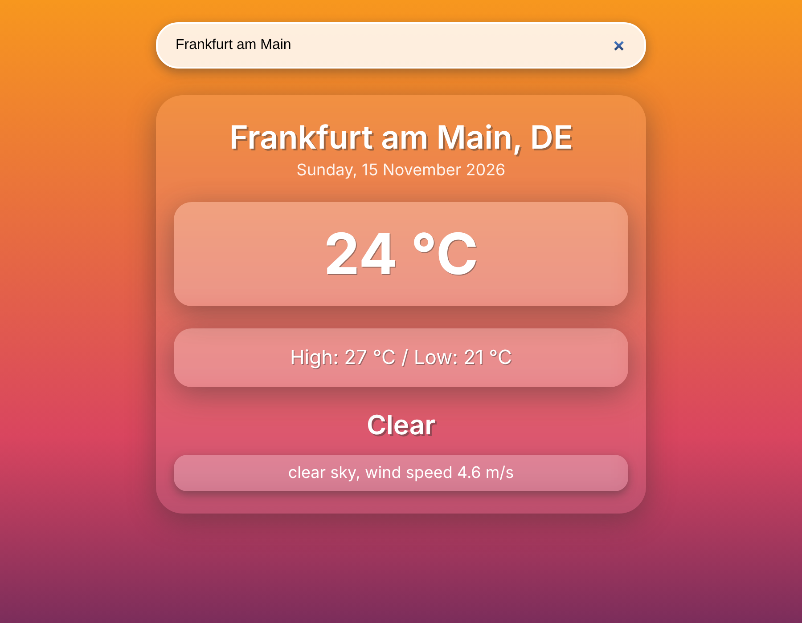
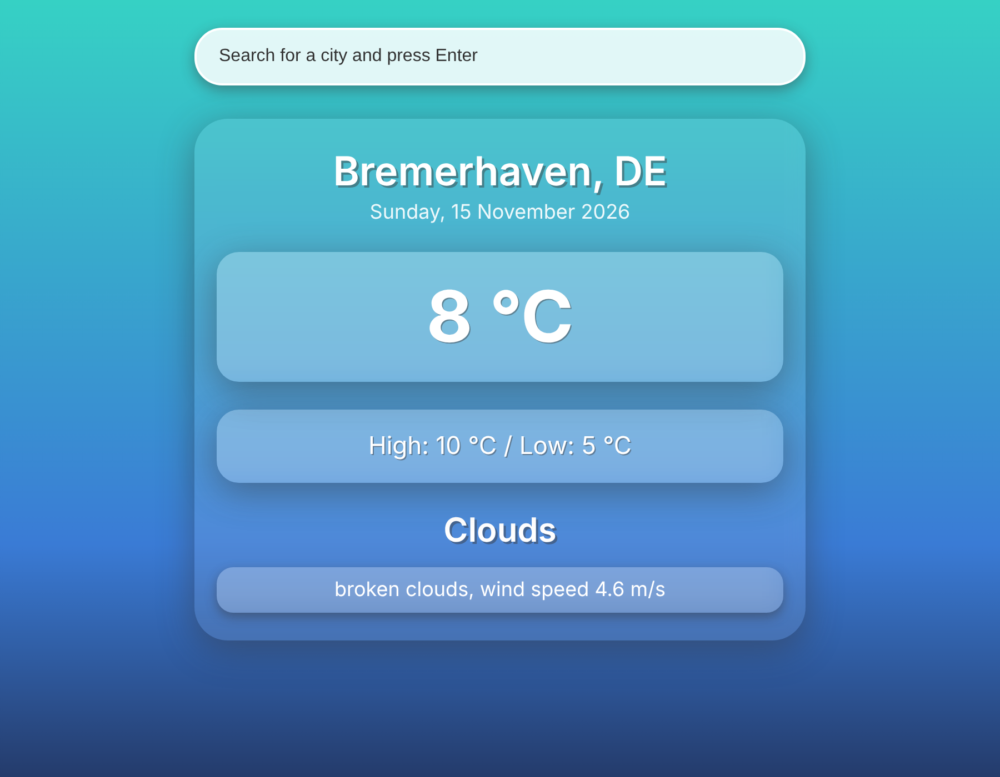

# Weather App

A small weather app built with plain HTML, CSS and JavaScript, without any frameworks or libraries.
It shows the current weather for your location or for a city you search for. The background changes with the temperature: warm colours above 18 °C, cool colours below.

| Warm | Cold |
|------|------|
|  |  |

The screenshots show the real interface with sample data.

## Features

- Search for the weather by city name (press Enter)
- Detects your city on first load (optional, via IP geolocation)
- Current temperature, high and low, weather description and wind speed
- Background changes with the temperature
- Clear messages for unknown cities, network problems and a missing API key
- Works on desktop and mobile

## Setup

The app needs a free API key from [OpenWeatherMap](https://openweathermap.org/api).

1. Copy `config.example.js` and name the copy `config.js`.
2. Enter your key in `config.js`.
3. Open `index.html` in your browser.

`config.js` is listed in `.gitignore`, so your key is not uploaded to GitHub.

Optional: add a key from [ipgeolocation.io](https://ipgeolocation.io) to detect the city automatically. Without it, the app starts with `defaultCity`.

## Technologies

- HTML5 and CSS3 (custom properties, gradients, backdrop filters)
- JavaScript (vanilla, `fetch` with `async`/`await`)
- [OpenWeatherMap API](https://openweathermap.org/current) for the weather data
- [IP Geolocation API](https://ipgeolocation.io) for the location (optional)

## Project structure

| File                | Purpose                                                  |
|---------------------|----------------------------------------------------------|
| `index.html`        | Structure of the page                                    |
| `main.css`          | Styling: gradients, glass effect, mobile layout          |
| `main.js`           | API requests, error handling, writing data into the page |
| `config.example.js` | Template for your API keys                               |

A step-by-step explanation of the code (in German) is in [docs/ERKLAERUNG.md](docs/ERKLAERUNG.md).

## Note on API keys

A key used in browser JavaScript is always visible to visitors of the page, even if it is not in the repository.
For a public deployment, the requests should go through a small server that keeps the key secret. For a local learning project, a free key in `config.js` is fine.
